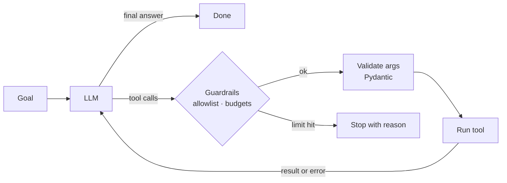

# Agentic Workflow Engine

**A small, typed engine for running tool-using LLM agents in production: with guardrails, full traces and an evaluation harness.**


Most agent demos work once and break in unpredictable ways. This project focuses on what makes an agent shippable:

| Problem in real agents | How this engine handles it |
|---|---|
| The model invents tool arguments | Tool schemas are generated from Python type hints; arguments are **validated with Pydantic before** the tool runs |
| A tool fails and the run crashes | Errors are returned to the model as observations so it can **self-correct**; a crashing tool never kills the run |
| Infinite loops and runaway cost | Guardrails for **max steps, max tool calls and a token budget** |
| Agents get access to dangerous tools | Per-agent **tool allowlist**: disallowed tools are hidden from the model *and* blocked at execution |
| "It worked when I tried it" | **Eval harness**: JSON test suites with answer, tool-usage and step checks, run in CI |
| Hard to debug | Every step is recorded in a **trace** and streamed live over SSE |
| Vendor lock-in | Provider-neutral core with **OpenAI and Anthropic** adapters |

## How it works



## Quick start

```bash
pip install -e ".[openai,dev]"
export OPENAI_API_KEY=sk-...

# Run an agent and watch its trace
agent-engine run "A team of 12 wants the Pro plan. What is the yearly cost in EUR?"

# Run the evaluation suite (exits non-zero below the pass-rate threshold)
agent-engine eval evals/suite.json --min-pass-rate 0.8
```

Example trace:

```
[step 1 · llm · 820ms] {'text': None, 'tool_calls': ['search_knowledge_base']}
[step 1 · tool_call] {'name': 'search_knowledge_base', 'arguments': {'query': 'Pro plan price'}}
[step 1 · tool_result] {'output': '[kb-2] The Pro plan costs 29 EUR per user per month, billed annually.'}
[step 2 · llm · 1610ms] {'text': None, 'tool_calls': ['calculator']}
[step 2 · tool_call] {'name': 'calculator', 'arguments': {'expression': '29 * 12 * 12'}}
[step 2 · tool_result] {'output': '4176'}
[step 3 · final] {'answer': 'The yearly cost for 12 users is 4,176 EUR.'}
```

Use Anthropic instead: `pip install -e ".[anthropic]"`, then set `LLM_PROVIDER=anthropic`, `LLM_MODEL=<model id>` and `ANTHROPIC_API_KEY`.

## Defining a tool

```python
from agent_engine import Agent, AgentConfig, ToolRegistry, tool
from agent_engine.llm import OpenAIChat

@tool(timeout_s=5)
def get_order_status(order_id: str, include_items: bool = False) -> str:
    """Look up the shipping status of an order by its id."""
    return orders_api.status(order_id, include_items)

agent = Agent(
    OpenAIChat("gpt-4o-mini"),
    ToolRegistry().register(get_order_status),
    AgentConfig(max_steps=6, max_total_tokens=20_000),
)
result = agent.run("Where is order A-1042?")
print(result.answer, result.stop_reason, result.tools_used())
```

The docstring becomes the tool description and the signature becomes the JSON schema. No hand-written schemas that drift from the code.

## HTTP API

```bash
uvicorn agent_engine.server:app --reload
curl -N -X POST localhost:8000/runs -H 'content-type: application/json' \
  -d '{"goal": "What is 17.5% of 2340?"}'
```

`POST /runs` streams Server-Sent Events: `llm`, `tool_call`, `tool_result` / `tool_error`, `guardrail`, `final`, then `done`. `GET /tools` lists tool schemas.

## Evaluations

`evals/suite.json` holds cases like:

```json
{
  "id": "multi-step-kb-plus-math",
  "goal": "A team of 12 wants the Pro plan. What is the yearly cost in EUR?",
  "expect_contains": ["4176"],
  "expect_tools": ["search_knowledge_base", "calculator"]
}
```

Checks available: `expect_contains`, `expect_regex`, `expect_tools`, `forbid_tools`, `max_steps`. The report shows pass rate, steps, tool calls, tokens and latency per case, so prompt or model changes can be compared with numbers instead of impressions.

## Testing

```bash
pytest
```

The test suite uses a deterministic `ScriptedLLM`, so the agent loop, guardrails, error recovery, eval harness and HTTP streaming are all tested **without network or API keys**.

## Project structure

```
agent_engine/
  agent.py        # the loop, guardrails, tracing
  tools/          # @tool decorator, registry, built-in safe tools
  llm.py          # provider-neutral messages + OpenAI / Anthropic adapters
  evals.py        # eval cases, checks, reports
  server.py       # FastAPI + SSE
  cli.py          # run / eval commands
evals/suite.json  # example evaluation suite
tests/            # 27 offline tests
```

## Roadmap

- [ ] Parallel tool execution with per-tool concurrency limits
- [ ] Persistent run storage and replay
- [ ] LLM-as-judge checks for open-ended answers
- [ ] OpenTelemetry export of traces

## License

MIT © Quy Nguyen
